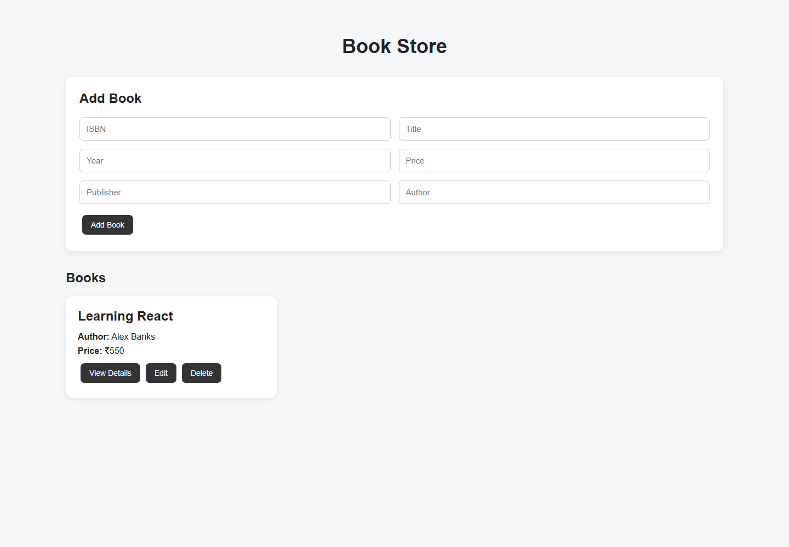

# Book Store

A full-stack book inventory app built with MongoDB, Express, React, and Node.js. The app lets users create, browse, edit, view, and delete book records.

## Screenshot



## Features

- Add a book with ISBN, title, year, price, publisher, and author
- Browse saved books
- View full book details
- Edit and delete books
- MongoDB persistence through a REST API

## Tech stack

- **Frontend:** React 19, Vite, Axios
- **Backend:** Node.js, Express 5
- **Database:** MongoDB with Mongoose

## Requirements

- Node.js and npm
- MongoDB running locally or a MongoDB connection URI

## Setup

### 1. Configure the backend

```powershell
cd backend
Copy-Item .env.example .env
npm install
```

Set `MONGO_URI` in `backend/.env` to your MongoDB connection string. The example uses `mongodb://localhost:27017/bookstore`.

### 2. Configure the frontend

```powershell
cd ..\frontend
Copy-Item .env.example .env
npm install
```

Set `VITE_API_URL` in `frontend/.env` to the backend API base URL, normally `http://localhost:5000/api`.

### 3. Run the app

Open two terminals from the project root:

```powershell
cd backend
npm run dev
```

```powershell
cd frontend
npm run dev
```

Open the local URL printed by Vite, usually `http://localhost:5173`.

## API

The API is available under `/api/books`:

| Method | Endpoint | Purpose |
| --- | --- | --- |
| `GET` | `/api/books` | List books |
| `GET` | `/api/books/:id` | Get a book |
| `POST` | `/api/books` | Create a book |
| `PUT` | `/api/books/:id` | Update a book |
| `DELETE` | `/api/books/:id` | Delete a book |

## Project layout

```text
backend/
  models/       Mongoose schemas
  routes/       Express API routes
  server.js     API server and MongoDB connection
frontend/
  src/          React app and styles
```

## Scripts

Run these from their respective directories:

| Directory | Command | Purpose |
| --- | --- | --- |
| `backend` | `npm run dev` | Start the API with Nodemon |
| `backend` | `npm start` | Start the API |
| `frontend` | `npm run dev` | Start the Vite development server |
| `frontend` | `npm run build` | Create a production build |
| `frontend` | `npm run lint` | Run Oxlint |
| `frontend` | `npm run preview` | Preview a production build |

## Configuration

Do not commit `.env` files or real credentials. Use the checked-in `.env.example` files as templates.
